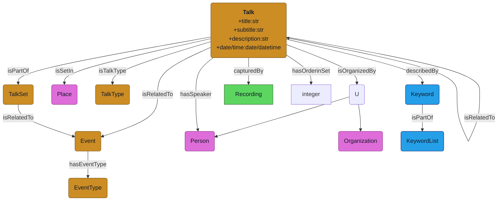

# Talk module - Scenario

## Description

An **Talk** submodule describes talks events organized by an ```Organization```. One talk may be related to one to many ```Recording```s. A talk may be a part of a serie of talks (```TalkSet```) that may be associated with an ```Event``` like a musical season, an exhibition, a serial conference, etc. It also can have related ```Talks``` that share common topics with it. It may be splitted in several parts (```TalkPart```) (multiple chapters and excerpts, with or without titles) and may included other ```Works``` (like musical excerpt, movie excerpt, etc.).

A ```Talk``` is described by a bunch of properties as:
* a ```title``` (mandatory)
* a ```subtitle``` (optional)
* a ```description``` or ```summary``` (optional)
* a ```date``` and ```time``` (mandatory for date, optional for time)
* a ```place``` (optional)
* a ```type``` of event/talk (optional)
* an ```organizer``` (natural or moral person)
* a list of ```speakers``` (optional)
* a list of ```keywords``` related to it's topic may be provided (optional)
* a list of ```persons``` related to the event may be provided (presents or mentionned) (optional)

A ```Speaker``` is a person entity. It may have a special role in the contect of the talk (being a guest specialist, a moderator or a member of the audience) and inherits of persons characteristics.

## Examples
### Example 1 : talk (1)
* **Identifier** : 732285
* **Title** : Le IIIe Reich et la musique : officiels et diffamés
* **Subtitle** : *Non renseigné*
* **Description** : 
    * **Texte**: Le régime national-socialiste, sous l'impulsion d'un dictateur convaincu qu'il fallait inscrire l'Allemagne nazie dans l'histoire plutôt que d'inventer un monde de toutes pièces, a orchestré les formes de l'art pour glorifier la pureté au détriment des arts qualifiés de "dégénérés" lorsqu'ils ne correspondaient pas aux critères officiels raciaux, moraux ou esthétiques. La musique a elle aussi servi cette propagande. Le répertoire pour piano rend d'ailleurs plus aiguë la fracture qui s'opérait entre art officiel et art libre, ce dernier revendiquant par exemple, des influences comme celles du jazz ou des musiques légères. 
    * **Source**: Extrait de la brochure de saison 2004-2005
* **Place** : Cité de la Musique
* **Date and time** : 20041009
* **Talk type** : Forum
* **Organizer**: Philharmonie de Paris - Cité de la Musique
* **Speakers** : Jeanne-Martine Vacher
* **Keywords** : 
    * DESC777922: Forum
    * DESC67786: Musicologie
    * DESC796376: Musique et histoire
    * DESC145872: 21 ème siècle
    * DESC1032654: Indexation approfondie
* **Related persons** : 
    * Creator: Jeanne-Martine Vacher
    * Contributors: Pascal Huynh, Georges Arthur Goldschmidt, Lionel Richard, Pierre Korsilius,
    Laurent Bayle
* **Related to** : *Le Troisième Reich et la musique (exhibition)*
* **URL**: https://pad.philharmoniedeparis.fr/player-conference.aspx#0732285

**Notes:**
* *Titres complets, lieu, description pas toujours renseignés via med-api mais visible sur PAD. Demander à Rodolphe*
* *La clé speakers dans l'api ne renseigne pas toujours tous les speakers qui peuvent se trouver aussi dans contributors. Creator ne reseigne pas toujours le réalisateur (ici: interviewer).*

### Example 2 : talk (2)
* **Title** : La musique à Terezin
* **Subtitle** : Jeanne-Martine Vacher - Fanny Malafosse - Gilles de Talhouet
* **Description** : 
    * **Texte**: Terezin (Theresienstadt) était, parmi les camps juifs instaurés par les nazis, une sorte de ville modèle. Avec ce miroir aux alouettes, Hitler voulait montrer au monde entier que les détenus vivaient heureux et qu'ils pouvaient poursuivre des activités culturelles plaisantes. De fait, comme pour mieux masquer l'oeuvre de mort qui s'y tramait en silence, le camp de Terezin a connu une vie musicale exceptionnelle, dont la figure dominante fut le compositeur Viktor Ullmann. De lui et des autres disparus restent des oeuvres poignantes. 
    * **Source**: Extrait de la brochure de saison 2004-2005*
* **Place** : Cité de la musique
* **Date and time** : 2004-10-23
* **Talk type** : Forum
* **Organizer**: Philharmonie de Paris
* **Speaker** : Jeanne-Martine Vacher
* **Keywords** : 
    * DESC777922: Forum
    * DESC67786: Musicologie
    * DESC145872: 21ème siècle
    * DESC1032654: Indexation approfondie
* **Related persons** : 
    * **Creator** : Jeanne-Martine Vacher
    * **Contributors** : Fanny Malafosse, Gilles de Talhouet
* **Related to** : *Le Troisième Reich et la musique (exhibition)*
* **URL** : https://pad.philharmoniedeparis.fr/player-conference.aspx#0732301

Notes: 
* *in this example, the subtitle is a list of the speakers, not a proper subtitle*
* the keyword taxonomie as also information about the type of talk and detailed indexation

### Example 3 : event (1)
* **Event title** : Le Troisième Reich et la musique
* **Event type** : exhibition
* **Start date** : 8 octobre 2004
* **End date** : 09 january  2005
* **Place** : Musée de la musique, Paris
* **URL** : https://pad.philharmoniedeparis.fr/exposition-le-troisieme-reich-et-la-musique.aspx

## Schema

