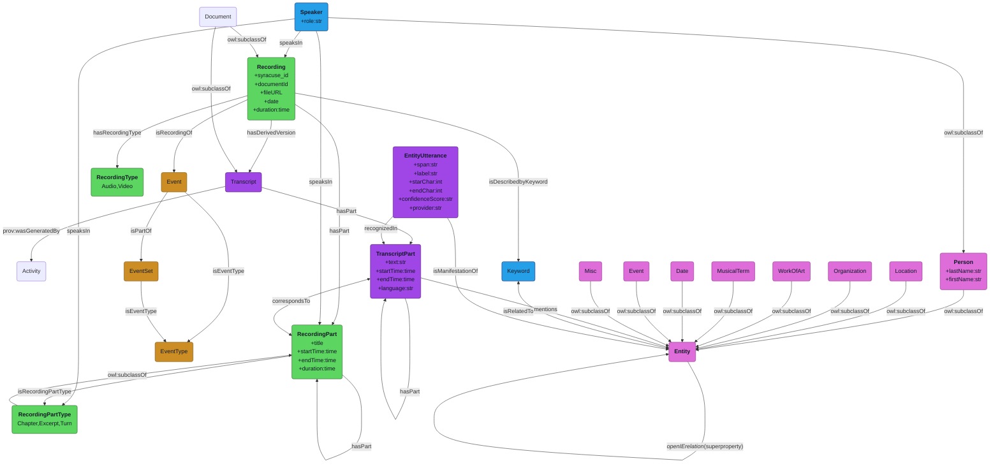

# Talks Ontology
The ontology contains 7 submodules :
- Events
- Recordings
- Metadata
- Entities
- Transcripts
- Activities
- Retrieval

## Overview


### Event
The event submodule describes ```Event``` elemnts organised by the an institution.
One event may lead to one ```Recording```. An event may be a part of a serie of events (```EventSet```) that may correspond to a season, an exhibition, a serial conference, etc which don't have a direct recording.
An event is set at a given date and place. 
It may have a certain type (keynote, commented concert etc).

### Recording
The recording submodule describes recordings (audio or video) of a given ```Event```. A recording has a duration, a date and place of recording. It can have derived version (vidoe derived to audio, audio tracks turn to text, etc.). 

### Metadata
Metadata is used to describes both ```Event``` and ```Recordings```. 
They include ```Speaker``` (someone who speak in an event) and ```Keyword``` (a taxonomy is maintained by librarians).

### Transcript
The transcript submodule refers to a derived, textual, version of a recording. 
A 
Each ```Recording``` has an equivalent ```Transcript``` item. 
Of course, ```RecordingPart``` is associated to a segment of that transcript (```TranscriptPart```).

### Entity
An entity can be associated with unique identifiers from external knowledge based (Wikidata, DOREMUS etc.).
Several subclasses have been defined : 
* ```Person```: a natural person. 
     * May have one or many activities (composer, moviemaker etc.)
     * May have created or played certain ```WorkOfArt```
     * Related to certain ```Location``` or ```Organization```
     * Related to certain ```Date``` or ```Event```
* ```MusicalTerm``` : music style, instrument, 
* ```WorkOfArt``` : name of a work of art, several domains are considered (music, cinema, litterature, painting) that may be mentionned in the conferences.
* ```Location``` : a named place
* ```Organization``` : an organization may be a political regime, a cultural institution (museuem) or association
* ```Date``` : a date is a temporal reference, that is an instant (numbered day in a month, a year, a century) or an interval (between two yeares etc.). 
* ```Event``` : an event refers to a dated instant or time interval. It can be an historical event or a cultural event mentionned in a conference.
* ```Miscellanous``` : any other relevant entity mentionned in documents

### Activity
An activity is a manual or automated process that lead to the creation of a resource (Transcript, Entity, Relation).

### Retrieval
This module aims to make the knowledge graph usable for semantic retrieval approaches. 